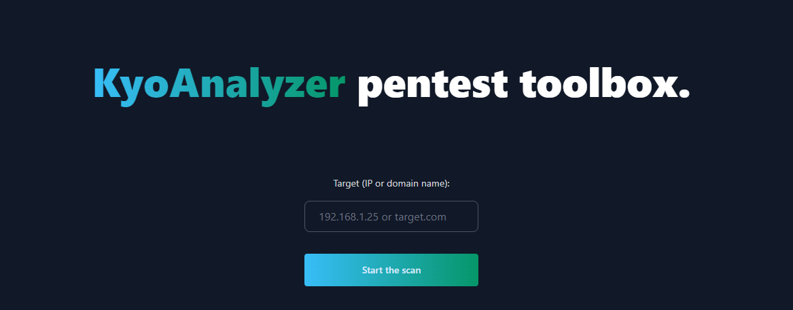

### Kynalyser

Kynalyser est une toolbox pour le pentest en particulier pour l'étape de la reconnaissance. 

Realisé en Python, elle permet de réaliser des scans de ports, de sous-domaines, de faire du DNS Mapping, du Reverse DNS Mapping, de récupérer des informations Whois et bien d'autres. 

Elle dispose d'une interface web simple et intuitive pour faciliter son utilisation.

Ce projet est réalisé dans le cadre d'un projet d'étude de SUP DE VINCI - CYBERSECURITY sous la supervision de M. BRAMLI Nathan

### Prérequis

- Kali Linux or Parrot OS
- Python 3.11 (recommandée)
- Connexion internet

### Installation

```bash
git clone https://github.com/Ky0ru/Kynalyser.git
cd Kynalyser
pip install -r requirements.txt
```
### Utilisation

```bash
python app.py
```

Ouvrez votre navigateur et allez à l'adresse suivante: http://localhost:8080

### Fonctionnalités

- [x] Whois
- [x] DNS Mapping (A, AAAA, MX, NS, SOA, TXT)
- [x] Reverse DNS Mapping
- [x] Subdomain Enumeration
- [x] Port Scanning
- [x] Subdomain Port Scanning

### Auteur
Julien MORENO
